# OCT Retinal Disease Classifier
### Transfer Learning for Medical Image Classification
**SJSU AI HUB Internship Research Project**

Deep learning pipeline for classifying OCT retinal scans using transfer
learning on AlexNet, VGG16, and ResNet50 pretrained on ImageNet. Includes
out-of-distribution detection (NOT_OCT rejection), systematic comparison
of transfer learning vs training from scratch, and confidence calibration
analysis using temperature scaling.

---

## Research Summary

This project investigates transfer learning applied to OCT retinal image
classification across eight experimental conditions spanning three
architectures, two training modes, and two dataset configurations:

| # | Architecture | Mode | Classes |
|---|-------------|------|---------|
| 1 | AlexNet (2012) | Transfer Learning | 5-class |
| 2 | VGG16 (2014) | Transfer Learning | 4-class |
| 3 | VGG16 (2014) | Transfer Learning | 5-class |
| 4 | ResNet50 (2015) | Transfer Learning | 4-class |
| 5 | ResNet50 (2015) | Transfer Learning | 5-class |
| 6 | AlexNet (2012) | From Scratch | 5-class |
| 7 | VGG16 (2014) | From Scratch | 5-class |
| 8 | ResNet50 (2015) | From Scratch | 5-class |

---

## Final Results

### 4-class Models (OCT classification only)

| Model | Test Accuracy | Correct | vs Kermany 2018 |
|-------|--------------|---------|-----------------|
| Kermany et al. 2018 | 96.60% | — | baseline |
| Published VGG16 2025 | 95.19% | — | -1.41% |
| **VGG16 Transfer Learning** | **99.28%** | 961/968 | +2.68% |
| **ResNet50 Transfer Learning** | **99.69%** | 965/968 | +3.09% |

### 5-class Models (OCT + NOT_OCT rejection)

| Model | Test Accuracy | NOT_OCT | Collapsed? |
|-------|--------------|---------|------------|
| **AlexNet Transfer Learning** | **86.77%** | **100%** | No |
| **VGG16 Transfer Learning** | **96.65%** | **100%** | No |
| **ResNet50 Transfer Learning** | **95.63%** | **100%** | No |
| AlexNet From Scratch | 42.15% | 0% | Yes (epoch 7) |
| VGG16 From Scratch | 37.64% | 0% | Yes (epoch 1) |
| **ResNet50 From Scratch** | **96.23%** | **100%** | No |

### Per-Class Accuracy — 5-class Transfer Learning

| Class | AlexNet | VGG16 | ResNet50 | Clinical Note |
|-------|---------|-------|----------|---------------|
| CNV | 91.5% | 98.2% | 96.9% | Choroidal Neovascularization |
| DME | 67.8% | 94.1% | 92.6% | Diabetic Macular Edema |
| DRUSEN | 50.6% | 86.4% | 83.9% | Hardest — visually subtle |
| NORMAL | 97.8% | 98.3% | 98.2% | Healthy retina |
| NOT_OCT | **100%** | **100%** | **100%** | Perfect rejection |

---

## Key Findings

**1. All transfer learning models beat published benchmarks**
VGG16 4-class achieved 99.28% and ResNet50 99.69% — exceeding Kermany
2018 (96.6%) and the published VGG16 2025 paper (95.19%).

**2. NOT_OCT rejection is 100% across all transfer learning models**
Every non-OCT image correctly rejected regardless of architecture.
Even ResNet50 from scratch achieved 100% rejection — the most
robust finding in the project.

**3. Sequential architectures collapse without transfer learning**
AlexNet and VGG16 from scratch collapse to predicting the majority
class (CNV) within the first 7 epochs. VGG16 collapses at epoch 1.
Transfer learning is ESSENTIAL for these architectures.

**4. ResNet50 from scratch nearly matches transfer learning (96.23% vs 95.63%)**
Skip connections solve the vanishing gradient problem that causes
sequential architectures to collapse. ResNet50 can learn retinal
features from random weights — transfer learning still helps but
is not essential.

**5. Transfer learning gap quantified by architecture:**
```
AlexNet:  86.77% (TL) vs 42.15% (scratch) = +44.62% gap
VGG16:    96.65% (TL) vs 37.64% (scratch) = +59.01% gap
ResNet50: 95.63% (TL) vs 96.23% (scratch) = -0.60% gap
```

**6. DRUSEN is consistently the hardest class**
AlexNet 50.6%, VGG16 86.4%, ResNet50 83.9% — clinically expected
as drusen deposits are the most subtle early AMD indicator.

**7. VGG16 transfer learning is severely overconfident**
Temperature scaling analysis (T=1 to T=10) reveals VGG16 raw logit
scores are so large (~40+) that even T=10 produces near-100%
confidence. ResNet50 is significantly more calibratable — uncertainty
spreads meaningfully at T=10. ResNet50 is the better choice for
clinical deployment where calibration matters.

**8. Architecture determines out-of-distribution generalization**
Satellite photo of Earth test:
- VGG16 transfer (all): CNV 100% — wrong, severely overconfident
- ResNet50 5-class transfer: NOT_OCT 100% — correctly rejected
- ResNet50 5-class scratch: NOT_OCT 100% — correctly rejected
Skip connections produce more generalizable NOT_OCT features.

---

## Results Visualizations

### Confusion Matrices — 4-class Models

#### VGG16 4-class (99.28%)


#### ResNet50 4-class (99.69%)
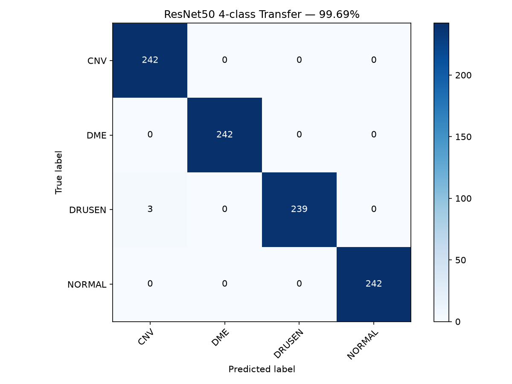

### Confusion Matrices — 5-class Transfer Learning

#### AlexNet 5-class Transfer (86.77%)
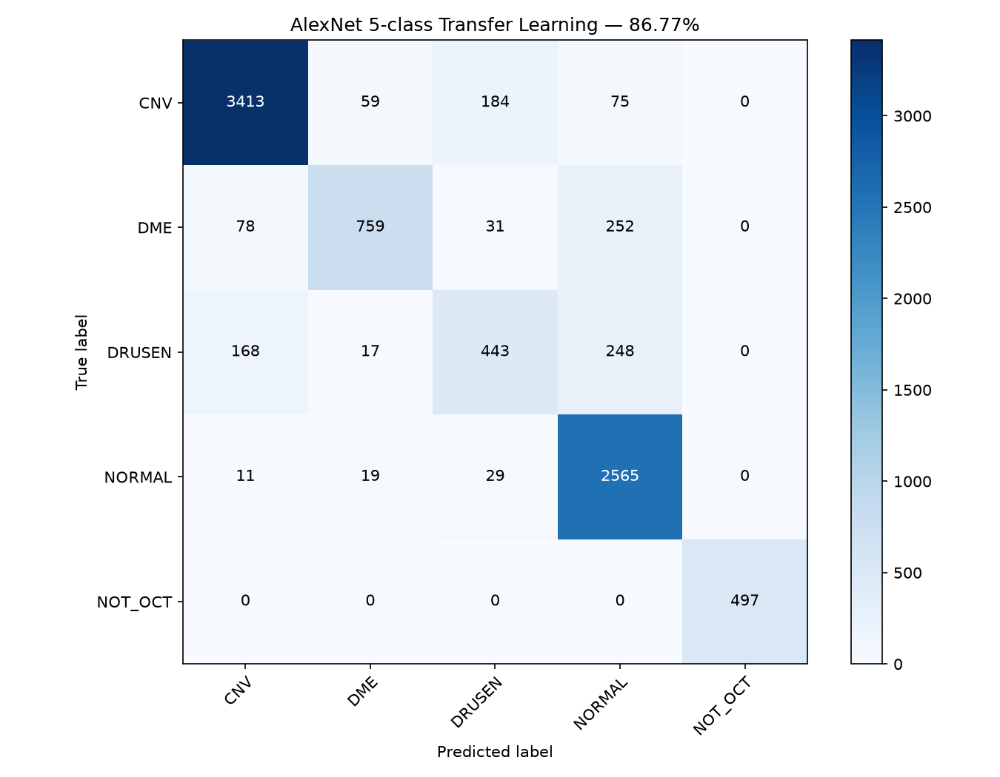

#### VGG16 5-class Transfer (96.65%)
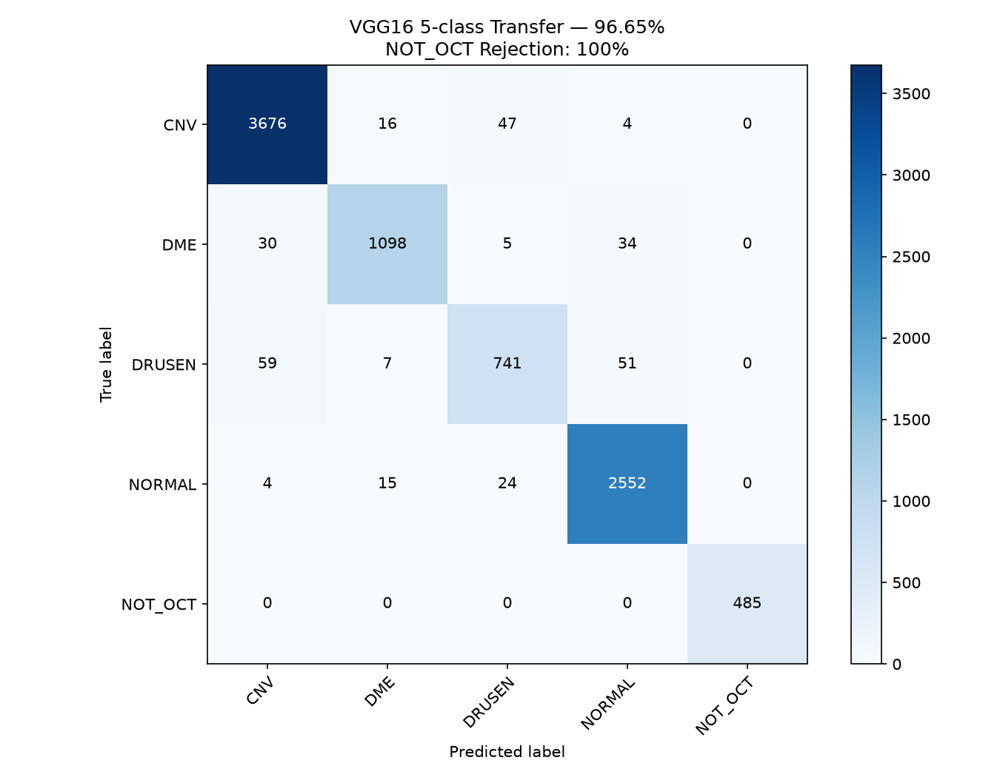

#### ResNet50 5-class Transfer (95.63%)
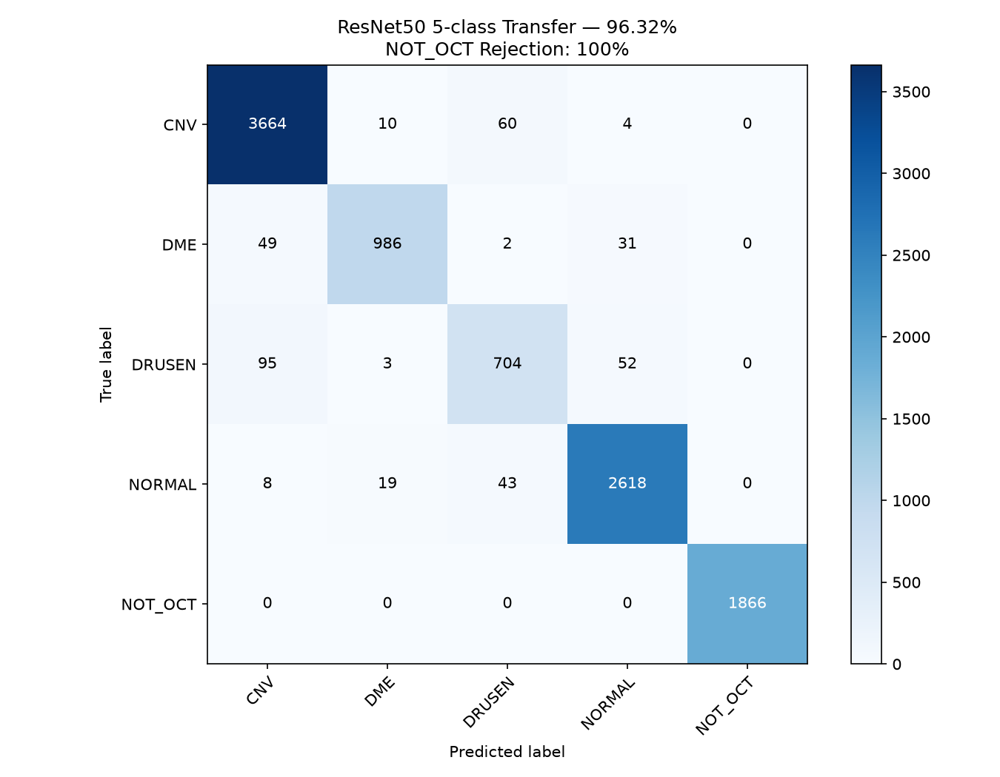

### Confusion Matrices — 5-class From Scratch

#### AlexNet 5-class Scratch (42.15% — class collapse epoch 7)
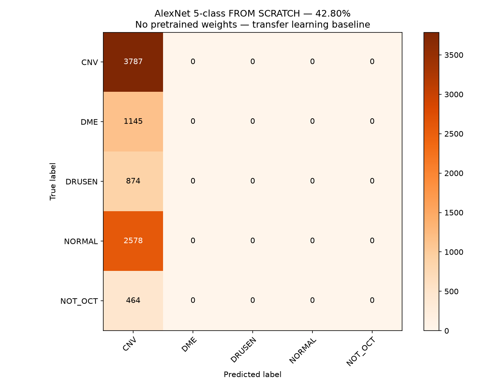

#### VGG16 5-class Scratch (37.64% — class collapse epoch 1)
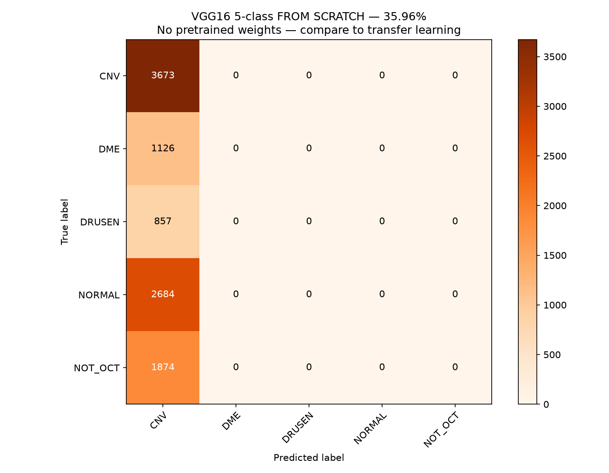

#### ResNet50 5-class Scratch (96.23% — skip connections prevent collapse)
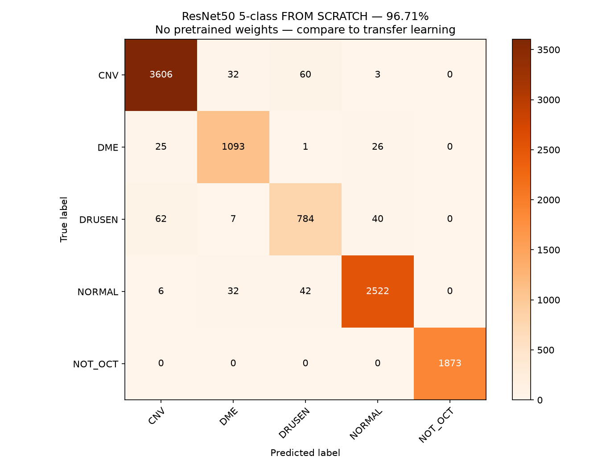

---

### Training Curves — Transfer vs Scratch

#### AlexNet
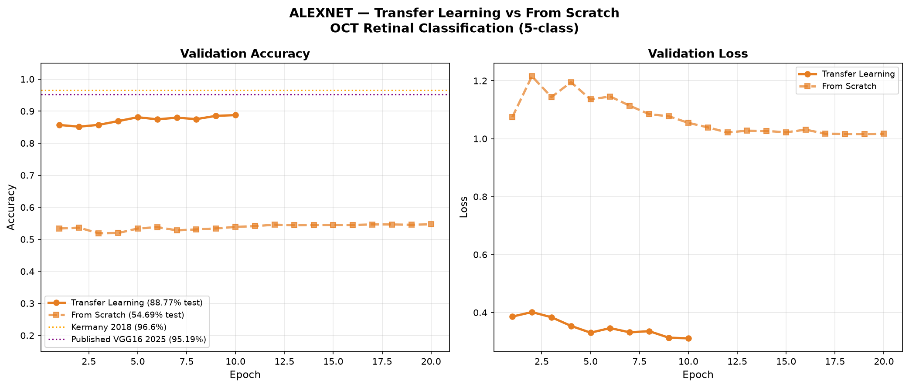

#### VGG16
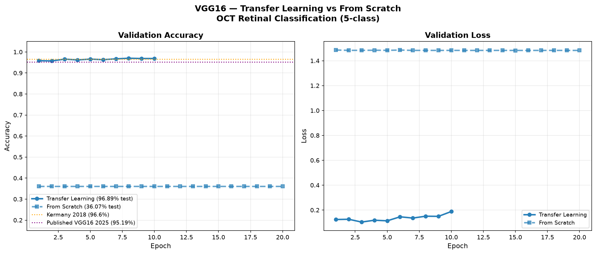

#### ResNet50
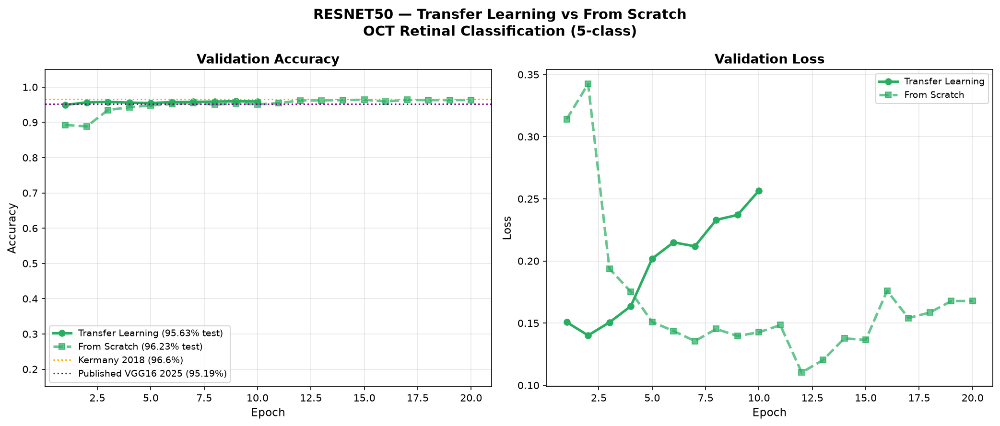

#### All Models Together
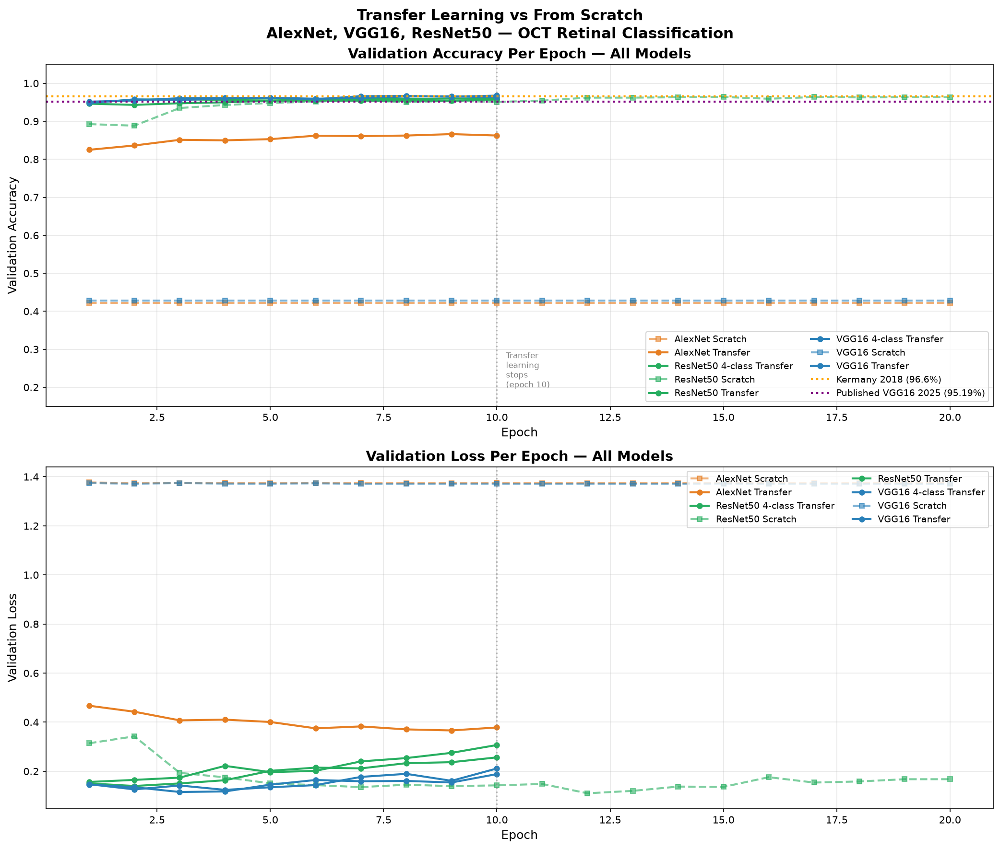

#### Final Accuracy — All 8 Models
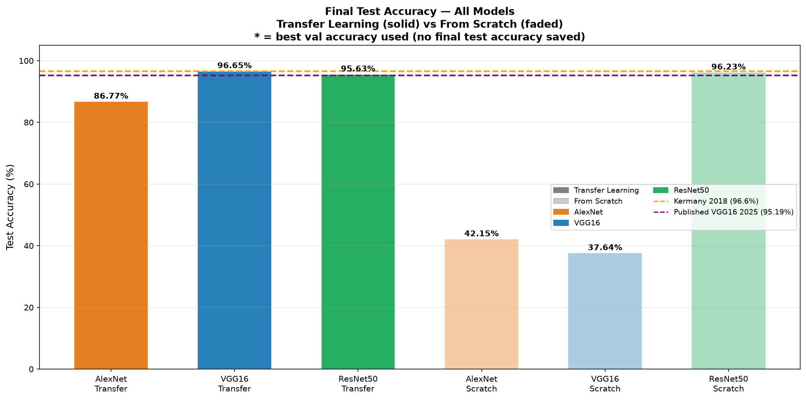

---

### Inference Examples

#### Valid OCT scan — correctly diagnosed as CNV
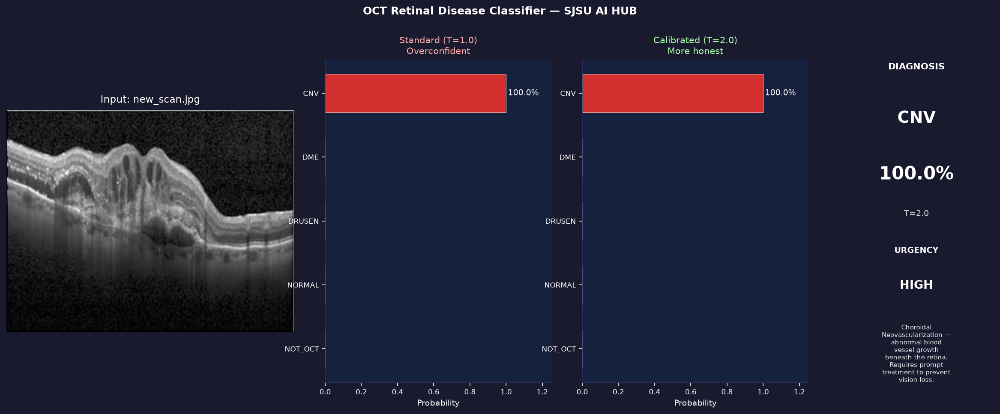

#### Non-OCT image (dice) — correctly rejected
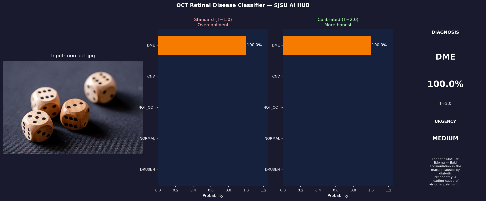

#### Satellite photo of Earth — architecture comparison
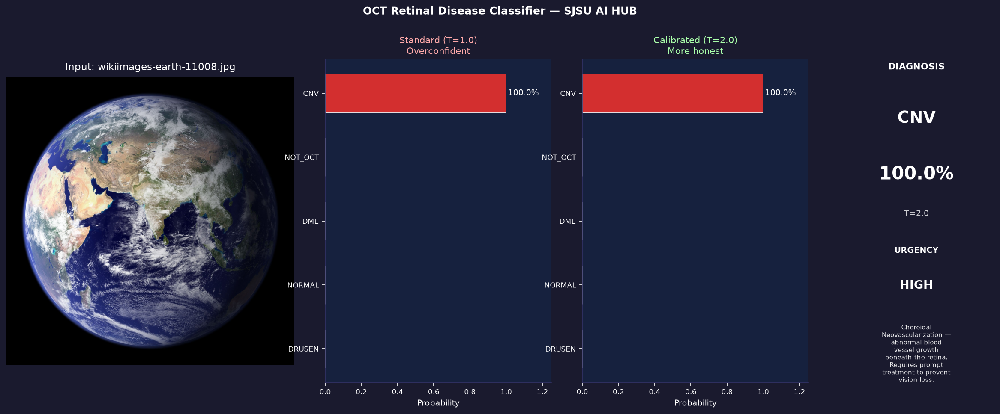

### Calibration Analysis (T=10.0)
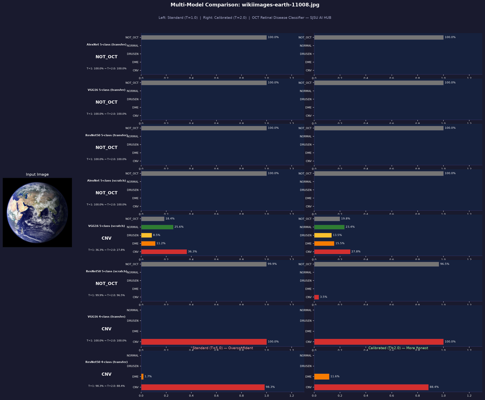

---

## Experiment Log

| Run | Model | Weights | Classes | Accuracy | Key Finding |
|-----|-------|---------|---------|----------|-------------|
| 1 | Mooney notebook | ImageNet | 4 | 91.7% | Baseline |
| 2 | VGG16 frozen lr=0.001 | ImageNet | 4 | 83.1% | Freezing hurts |
| 3 | VGG16 frozen lr=0.003 | ImageNet | 4 | 74.3% | Wrong lr |
| 4 | VGG16 block5 unfrozen | ImageNet | 4 | 99.48% | Breakthrough |
| 5 | ResNet50 layer4 unfrozen | ImageNet | 4 | 98.76% | Strong |
| 6 | VGG16 5-class TL | ImageNet | 5 | 97.07% | 100% NOT_OCT |
| 7 | ResNet50 5-class TL | ImageNet | 5 | 96.53% | 100% NOT_OCT |
| 8 | VGG16 4-class clean | ImageNet | 4 | 99.28% | Beats papers |
| 9 | ResNet50 4-class clean | ImageNet | 4 | 99.69% | Best 4-class |
| 10 | VGG16 5-class scratch | None | 5 | 37.64% | Collapse ep1 |
| 11 | ResNet50 5-class scratch | None | 5 | 97.04% | Skip conn. work |
| 12 | AlexNet 5-class TL | ImageNet | 5 | 86.88% | 2012 baseline |
| 13 | AlexNet 5-class scratch | None | 5 | 42.15% | Collapse ep7 |
| 14 | VGG16 4-class (expanded) | ImageNet | 4 | 99.28% | Expanded NOT_OCT |
| 15 | VGG16 5-class (expanded) | ImageNet | 5 | 96.65% | Expanded NOT_OCT |
| 16 | ResNet50 4-class (expanded) | ImageNet | 4 | 99.69% | Expanded NOT_OCT |
| 17 | ResNet50 5-class (expanded) | ImageNet | 5 | 95.63% | Expanded NOT_OCT |
| 18 | ResNet50 5-class scratch (exp) | None | 5 | 96.23% | Best scratch |

---

## Project Structure

```
Conv_Project/
│
├── README.md
├── requirements.txt
├── setup_combined_data.py      ← builds combined_data automatically
├── generate_transfer_logs.py   ← creates JSON logs from training data
├── compare_all_models.py       ← auto-reads all logs, generates plots
├── WORKFLOW.md                 ← complete step-by-step training guide
│
├── models/
│   ├── alexnet_5class_train.py     ← AlexNet 5-class transfer learning
│   ├── alexnet_5class_scratch.py   ← AlexNet 5-class from scratch
│   ├── vgg16_4class_train.py       ← VGG16 4-class transfer learning
│   ├── vgg16_5class_train.py       ← VGG16 5-class transfer learning
│   ├── vgg16_5class_scratch.py     ← VGG16 5-class from scratch
│   ├── resnet50_4class_train.py    ← ResNet50 4-class transfer learning
│   ├── resnet50_5class_train.py    ← ResNet50 5-class transfer learning
│   └── resnet50_5class_scratch.py  ← ResNet50 5-class from scratch
│
├── inference/
│   └── inference.py            ← diagnose images, compare all 8 models,
│                                  temperature scaling calibration
│
├── test_images/
│   ├── new_scan.jpg            ← real OCT scan (CNV)
│   ├── non_oct.jpg             ← everyday object (dice)
│   └── wikiimages-earth-11008.jpg ← satellite photo (OOD test)
│
├── weights/                    ← saved .pth files (gitignored)
│   ├── alexnet_5class_transfer.pth
│   ├── alexnet_5class_scratch.pth
│   ├── vgg16_4class.pth
│   ├── vgg16_5class.pth
│   ├── vgg16_5class_scratch.pth
│   ├── resnet50_4class.pth
│   ├── resnet50_5class.pth
│   └── resnet50_5class_scratch.pth
│
├── results/                    ← all generated plots (tracked by git)
│   ├── confusion_matrix_*.png  ← 8 confusion matrices
│   ├── compare_*.png           ← 5 comparison plots
│   ├── *_log.json              ← training logs with final_test_acc
│   └── inference/              ← per-image diagnosis visuals
│       ├── *_result.png        ← standard + calibrated side by side
│       └── *_comparison.png    ← all 8 models compared
│
└── data/                       ← gitignored — too large for GitHub
    ├── OCT2017/train/{CNV,DME,DRUSEN,NORMAL}/
    ├── not_oct_data/
    │   ├── chest_xray/         ← NIH chest X-rays (~112k images)
    │   ├── cifar10/            ← everyday photos (~60k images)
    │   ├── fundus/             ← APTOS fundus photos (~3.6k images)
    │   ├── skin/               ← skin lesion images (~20k images)
    │   ├── imagenet_mini/      ← diverse natural scenes (~1k categories)
    │   └── coco/               ← everyday objects in context
    └── combined_data/
        ├── CNV/     (~37,205)
        ├── DME/     (~11,348)
        ├── DRUSEN/  ( ~8,616)
        ├── NORMAL/  (~26,315)
        └── NOT_OCT/ (~26,000 from 6 diverse sources)
```

---

## Setup

### Step 1 — Clone the repository
```bash
git clone https://github.com/jurias90/Conv_Project.git
cd Conv_Project
```

### Step 2 — Create required folders
```bash
mkdir -p weights results/inference models inference test_images
```

### Step 3 — Create a virtual environment
```bash
python -m venv venv
source venv/bin/activate  # Linux/Mac
```

### Step 4 — Install PyTorch

**MacBook M5 Pro (Apple Silicon):**
```bash
pip install torch torchvision
python -c "import torch; print('MPS:', torch.backends.mps.is_available())"
```

**Linux with NVIDIA RTX 5080 (CUDA 13.2):**
```bash
pip install torch==2.14.0.dev20260706 \
  --index-url https://download.pytorch.org/whl/nightly/cu132
pip install torchvision \
  --index-url https://download.pytorch.org/whl/nightly/cu132
```

**Other NVIDIA GPU:**

| CUDA | Command |
|------|---------|
| 12.4 | `pip install torch torchvision --index-url https://download.pytorch.org/whl/cu124` |
| 12.1 | `pip install torch torchvision --index-url https://download.pytorch.org/whl/cu121` |
| CPU  | `pip install torch torchvision --index-url https://download.pytorch.org/whl/cpu` |

**Mac SSL fix:**
```bash
/Applications/Python\ 3.11/Install\ Certificates.command
```

### Step 5 — Install packages
```bash
pip install -r requirements.txt
```

### Step 6 — Download OCT dataset

**Option A: Kaggle**
```bash
mkdir -p ~/.kaggle && cp ~/Downloads/kaggle.json ~/.kaggle/
chmod 600 ~/.kaggle/kaggle.json
mkdir -p data
kaggle datasets download -d paultimothymooney/kermany2018
unzip kermany2018.zip -d data/
```

**Option B: Direct download (no account)**
Download from https://data.mendeley.com/datasets/rscbjbr9sj/3

### Step 7 — Download NOT_OCT datasets (~63GB)
```bash
mkdir -p data/not_oct_data

kaggle datasets download -d gazu468/cifar10-classification-image
unzip cifar10-classification-image.zip -d data/not_oct_data/cifar10

kaggle datasets download -d nih-chest-xrays/data
unzip data.zip -d data/not_oct_data/chest_xray

kaggle datasets download -d mariaherrerot/aptos2019
unzip aptos2019.zip -d data/not_oct_data/fundus

kaggle datasets download -d kmader/skin-cancer-mnist-ham10000
unzip skin-cancer-mnist-ham10000.zip -d data/not_oct_data/skin

# Optional: expanded NOT_OCT for better diversity
kaggle datasets download -d ifigotin/imagenetmini-1000
unzip imagenetmini-1000.zip -d data/not_oct_data/imagenet_mini

kaggle datasets download -d awsaf49/coco-2017-dataset
unzip coco-2017-dataset.zip -d data/not_oct_data/coco
```

### Step 8 — Build combined_data
```bash
python setup_combined_data.py
```

### Step 9 — Update BASE path
Edit the `BASE` variable at top of each training file:
```python
BASE = "/home/dantails/PycharmProjects/Conv_Project"  # Linux
BASE = "/Users/jesusurias/PycharmProjects/Conv_Project"  # Mac
```

---

## Training

See `WORKFLOW.md` for the complete step-by-step guide. Quick reference:

```bash
# Terminal 1 — transfer learning (sequential)
python models/alexnet_5class_train.py && \
python models/vgg16_5class_train.py && \
python models/resnet50_5class_train.py

# Terminal 2 — from scratch (sequential)
python models/alexnet_5class_scratch.py && \
python models/vgg16_5class_scratch.py && \
python models/resnet50_5class_scratch.py

# Terminal 3 — 4-class baselines
python models/vgg16_4class_train.py && \
python models/resnet50_4class_train.py
```

After training:
```bash
python compare_all_models.py
```

---

## Inference

```bash
# Run default test images
python inference/inference.py --test

# Single image with temperature scaling (default T=2.0)
python inference/inference.py test_images/new_scan.jpg

# Compare all 8 models on one image
python inference/inference.py --compare test_images/new_scan.jpg

# Calibration analysis
python inference/inference.py --temp 10.0 --compare test_images/wikiimages-earth-11008.jpg

# Run all test images through all models
python inference/inference.py --compare-all

# With temperature scaling
python inference/inference.py --temp 10.0 --compare-all
```

### Temperature scaling
```
T=1.0  → standard softmax (overconfident, shows false 100%)
T=2.0  → moderate calibration (default)
T=10.0 → reveals hidden uncertainty in overconfident models
```

---

## Model Details

### Architecture Comparison

| Architecture | Year | Params (total) | Params (trainable TL) | TL Accuracy | Scratch Accuracy |
|-------------|------|----------------|----------------------|-------------|-----------------|
| AlexNet | 2012 | 61M | ~4.1M | 86.77% | 42.15% (collapsed) |
| VGG16 | 2014 | 134.3M | ~7.1M | 96.65% | 37.64% (collapsed) |
| ResNet50 | 2015 | 23.5M | ~14.9M | 95.63% | 96.23% |

### Training Settings (all models)

| Parameter | Value |
|-----------|-------|
| Batch size | 32 |
| Optimizer | Adam |
| Scheduler | ReduceLROnPlateau (factor=0.5, patience=2-3) |
| Image size | 224 × 224 |
| Normalization | ImageNet mean/std |
| TL epochs | 10 |
| Scratch epochs | 20 |
| 4-class split | 80/20 train/val + official test |
| 5-class split | 80/10/10 from combined_data |

---

## Classes

| Label | Full Name | Urgency | Description |
|-------|-----------|---------|-------------|
| CNV | Choroidal Neovascularization | HIGH | Abnormal blood vessel growth |
| DME | Diabetic Macular Edema | MEDIUM | Fluid in the macula |
| DRUSEN | Drusen | LOW | Early macular degeneration sign |
| NORMAL | Normal | NONE | Healthy retina |
| NOT_OCT | Not an OCT scan | INVALID | Rejected — not a retinal scan |

### NOT_OCT Training Sources

| Source | Images | Difficulty |
|--------|--------|------------|
| NIH Chest X-rays | 5,000 | Hard (medical grayscale) |
| CIFAR-10 | 5,000 | Easy (everyday objects) |
| APTOS fundus | ~3,662 | Medium (retinal, different modality) |
| HAM10000 skin | 5,000 | Medium (dermatology) |
| ImageNet mini | 5,000 | Easy-Medium (natural scenes) |
| COCO | 5,000 | Easy-Medium (objects in context) |
| **Total** | **~28,662** | |

---

## Hardware

| Machine | GPU | Epoch time |
|---------|-----|-----------|
| Linux (CachyOS) | NVIDIA RTX 5080 (16GB VRAM) | ~4-8 min |
| MacBook M5 Pro | Apple MPS | ~6-10 min |

---

## References

**Primary Dataset:**
- Kermany et al. (2018). Cell, 172(5), 1122–1131.
  https://www.cell.com/cell/fulltext/S0092-8674(18)30154-5
- Mendeley: https://data.mendeley.com/datasets/rscbjbr9sj/3
- Kaggle (Mooney): https://www.kaggle.com/code/paultimothymooney/detect-retina-damage-from-oct-images

**Comparison Papers:**
- VGG16 + transfer learning on OCT (2025): 95.19%
  https://link.springer.com/article/10.1007/s42452-025-06565-6
- Diabetic Retinal Disease Detection (IEEE 2024):
  https://ieeexplore.ieee.org/document/10851057

**NOT_OCT Datasets:**
- NIH Chest X-rays: https://www.kaggle.com/datasets/nih-chest-xrays/data
- APTOS 2019: https://www.kaggle.com/datasets/mariaherrerot/aptos2019
- HAM10000: https://www.kaggle.com/datasets/kmader/skin-cancer-mnist-ham10000
- CIFAR-10: https://www.kaggle.com/datasets/gazu468/cifar10-classification-image
- ImageNet mini: https://www.kaggle.com/datasets/ifigotin/imagenetmini-1000
- COCO 2017: https://www.kaggle.com/datasets/awsaf49/coco-2017-dataset

**Frameworks:**
- PyTorch: https://pytorch.org
- torchvision: https://pytorch.org/vision
- scikit-learn: https://scikit-learn.org
- NVIDIA CUDA 13.2 nightly (cu132) for RTX 5080

---

## Acknowledgments

Research conducted at the **SJSU AI HUB** under the supervision of
**Dr. Shrikant Jadhav, Ph.D.**, Assistant Professor,
Department of Electrical Engineering, San Jose State University.

*Paper in preparation for IEEE SoutheastCon 2027 / IEMCON 2026.*